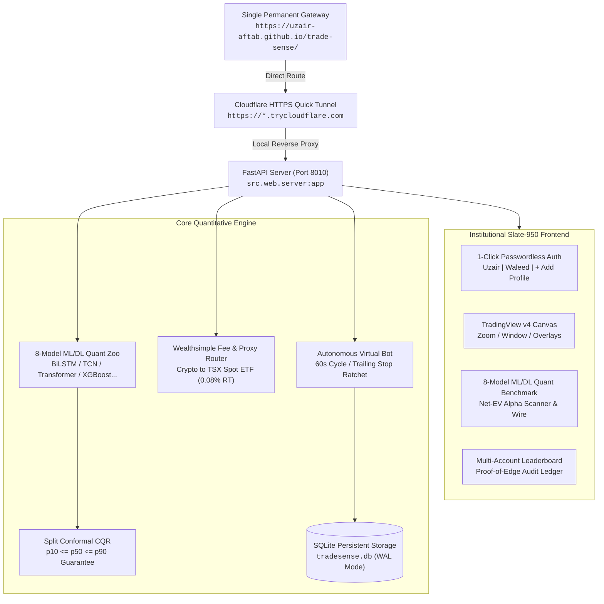

# TradeSense v7 — Technical Architecture (`ARCHITECTURE.md`)

> **Version**: `v7.0.0-institutional`  
> **Platform**: Institutional Algorithmic Trading & Probabilistic Quant System  
> **Stack**: FastAPI, TradingView Lightweight Charts v4, PyTorch CUDA (RTX 4070 Laptop GPU), SQLite WAL

---

## 1. Executive System Topology

---

## 2. Zero Lookahead Bias & Causal Matrix Pipeline

### 2.1 Causal Feature Engineering
All feature transforms strictly reference contemporaneous and past bars:
$$\mathbf{X}_t = f(\mathbf{p}_{t}, \mathbf{p}_{t-1}, \dots, \mathbf{p}_{t-k})$$

- **Returns**: $r_t = \ln(C_t / C_{t-1})$
- **Volatility**: $\sigma_{20} = \text{std}(r_{t-19:t})$, ATR, Bollinger Bandwidth
- **Trend & Momentum**: MACD signal, RSI(14), EMA ratios ($C_t / \text{EMA}_{21,t}$)
- **Whale Tracker**: Volume anomalies $\text{Vol}_t > \mu_{\text{Vol}} + 2.5 \sigma_{\text{Vol}}$
- **No Backward Fill**: Missing initial values are filled forward only or dropped; never back-filled from future bars.

### 2.2 Target Formulation & Embargoed Walk-Forward Splits
Target returns over horizon $H$ bars:
$$y_t = \frac{C_{t+H} - C_t}{C_t}$$

For any walk-forward validation split ending at bar $T_{\text{train}}$:
- The training label $y_{T_{\text{train}}}$ requires price at $T_{\text{train}} + H$.
- An **embargo window** of $H$ bars is enforced:
  $$\text{Train Index} \le T_{\text{train}} - H, \quad \text{Test Index} \ge T_{\text{train}}$$
- This mathematically guarantees zero target leakage across folds.

---

## 3. 8-Model Quant Zoo & Split Conformal CQR

Each of the 8 models implements the `BaseQuantModel` interface:

| Model ID | Architecture | Paradigm | Specialization |
| :--- | :--- | :--- | :--- |
| `dl_bilstm_attn` | Attention-BiLSTM Net | Deep Learning | Sequential momentum & swing dynamics |
| `dl_tcn_resnet` | Dilated TCN-ResNet | Deep Learning | Multi-scale causal dilated convolutions |
| `dl_transformer` | Multi-Head Transformer | Deep Learning | High-beta regime shifts & attention |
| `ml_xgboost_quantile` | XGBoost Quantile | Tree ML | Pinball loss quantile trees & feature importance |
| `ml_gbdt_forest` | ExtraTrees + HistGBDT | Tree ML | Overfit-resistant randomized ensembles |
| `ml_svr_bayesian` | RBF-SVR + Bayesian Ridge | Statistical ML | Non-linear margin & shrinkage |
| `quant_kalman_garch` | Kalman State-Space + GARCH | Econometric | Latent drift velocity & volatility clustering |
| `nlp_flow_meta` | NLP Catalyst + Whale Flow | Multimodal | FinBERT/VADER sentiment & volume flow |

### Split Conformal CQR (Conformalized Quantile Regression)
Predictions are calibrated on held-out calibration residuals:
$$E_i = \max(p_{10}(X_i) - y_i, y_i - p_{90}(X_i))$$
Using the $(1 - \alpha)(1 + 1/n)$-th empirical quantile $Q$:
$$p_{10}^{\text{cal}} = p_{10}(X) - Q, \quad p_{90}^{\text{cal}} = p_{90}(X) + Q$$
Strict monotonicity $p_{10} \le p_{50} \le p_{90}$ is enforced across all models and consensus syntheses.

---

## 4. Wealthsimple Fee Accounting & CAD Proxy Routing

Wealthsimple execution friction is modeled with precision:
- **Crypto Direct**: 2.0% one-way fee + 0.05% slippage = 4.10% round-trip hurdle.
- **TSX Equities & Canadian ETFs**: \$0 commission + 0.04% slippage = 0.08% round-trip hurdle.
- **US Equities (CAD Account)**: 1.5% FX one-way + 0.04% slippage = 3.08% round-trip hurdle.

### Smart CAD ETF Proxy Engine
When enabled (default), TradeSense routes underlying crypto tickers to Canadian TSX Spot ETFs:
- `BTC-CAD` $\rightarrow$ `BTCC.TO` (Purpose Bitcoin ETF)
- `ETH-CAD` $\rightarrow$ `ETHX-B.TO` (CI Galaxy Ethereum ETF)
- `SOL-CAD` $\rightarrow$ `SOLQ.TO` (3iQ Solana Staking ETF)

**Economic Impact**: Trading \$10,000 of Bitcoin via `BTCC.TO` incurs \$8 CAD round-trip friction vs \$410 CAD direct on Wealthsimple Crypto, saving **\$402 CAD per trade** and qualifying for TFSA/RRSP tax-exempt gains.

---

## 5. Security & Session Management

- **Cookie Protocol**: `tradesense_session` signed using HMAC-SHA256 secret.
- **Payload**: Base64 JSON containing `profile_id`, `created_at`, `expires_at` (90 days).
- **Public Server Architecture**: Tunnel endpoint updates a private GitHub Gist, serving as the lookup backbone for the public GitHub Pages gateway without exposing local IPs or credentials.
