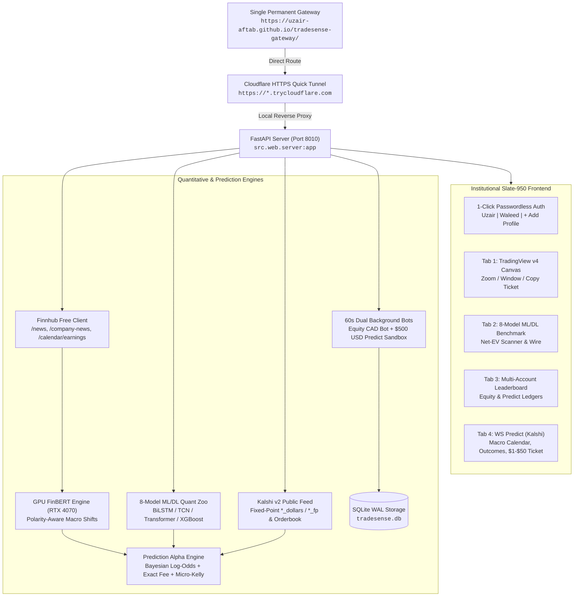

# TradeSense v8 — Technical Architecture (`ARCHITECTURE.md`)

> **Version**: `v8.0.0-institutional`  
> **Platform**: Institutional Algorithmic Trading, GPU FinBERT & Wealthsimple Predict Simulator  
> **Stack**: FastAPI, TradingView Lightweight Charts v4, PyTorch CUDA (RTX 4070 Laptop GPU), `ProsusAI/finbert`, Finnhub v1, Kalshi Public API v2, SQLite WAL

---

## 1. Executive System Topology

---

## 2. Zero Lookahead Bias & Causal Matrix Pipeline

### 2.1 Causal Feature Engineering
All feature transforms strictly reference contemporaneous and past bars:
$$\mathbf{X}_t = f(\mathbf{p}_{t}, \mathbf{p}_{t-1}, \dots, \mathbf{p}_{t-k})$$
- Embargoed walk-forward validation guarantees zero label leakage across horizon $H$.
- Split Conformal CQR guarantees finite, monotonically ordered quantiles $p_{10} \le p_{50} \le p_{90}$.

---

## 3. GPU FinBERT & Polarity-Aware Macro Mapping (v8)

### 3.1 Batched CUDA Inference & SHA-256 Caching
`src/data/finbert_engine.py` loads `ProsusAI/finbert` in fp16 on CUDA (`RTX 4070`), reading dynamic label indices (`model.config.id2label`) to avoid hardcoded label-mapping errors, and caches scored headlines by SHA-256 hash.

### 3.2 Directional Polarity Inversion Fix
Standard sentiment models score headlines such as *"Hot CPI keeps Fed hawkish and delays rate cuts"* negatively (`net_score < 0`). `score_macro_polarity` aligns hawkish/dovish macro cues with each event contract's resolution criteria:
- **Cut Contracts** (`Cut 25bps`, `Cut >25bps`): hawkish cues decrease YES probability (`directional_shift < 0`).
- **Hike Contracts** (`Hike 25bps`, `Hike >25bps`): hawkish cues increase YES probability (`directional_shift > 0`).
- **Hold Contracts** (`Fed maintains rate`): moderate stability boosts Hold odds while extreme surprises compress them.

---

## 4. Kalshi / Wealthsimple Predict Architecture (v8)

### 4.1 2026 Fixed-Point Schema & Canadian CIRO Compliance
`src/data/prediction_feed.py` parses Kalshi v2 fixed-point string decimals (`yes_bid_dollars`, `yes_ask_dollars`, `volume_fp`, `open_interest_fp`, `orderbook_fp`) and filters to CIRO-authorized categories (`Economics`, `Financials`, `Climate and Weather`), excluding sports and political contracts while tracking original contract term days.

### 4.2 Bayesian Log-Odds Probability & Exact Fees
Starting from market midpoint prior $L_0 = \ln\frac{p_{\text{mkt}}}{1 - p_{\text{mkt}}}$:
$$L_{\text{fair}} = L_0 + \Delta L_{\text{FinBERT}} + \Delta L_{\text{Quant/Macro}} + \Delta L_{\text{Orderbook}}$$
$$q = \sigma(L_{\text{fair}})$$

Kalshi variable taker fees follow the exact ceiling cent formula:
$$\text{Fee}(C, P) = \frac{\lceil 100 \times M \times 0.07 \times C \times P \times (1 - P) \rceil}{100}$$

### 4.3 Virtual Predict Sandbox & Brier Score Audit
Each user holds a dedicated `$500.00 USD` Predict Sandbox supporting `$1.00 USD` minimum stakes, live bid early exits, automatic `$1.00`/`$0.00` contract settlement, optional `$5` Auto-Pilot (`>= +4.0%` Net EV), and Brier calibration comparison:
$$\text{Brier}_{\text{AI}} = \frac{1}{N} \sum_{i=1}^N (q_i - y_i)^2 \quad \text{vs.} \quad \text{Brier}_{\text{Mkt}} = \frac{1}{N} \sum_{i=1}^N (p_{\text{mkt},i} - y_i)^2$$
