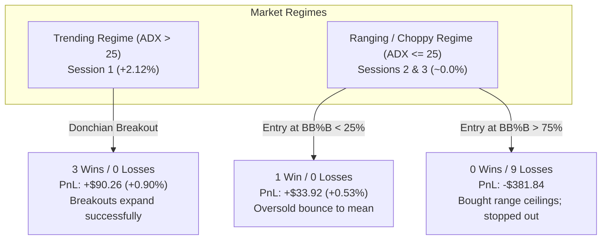

# TradeSense Empirical Research Findings & Quant Strategy Post-Mortem

> **Document Purpose**: Authoritative empirical findings, failure-mode diagnoses, and quantitative architectural specifications compiled from multi-session live microstructure telemetry.
> **Target Audience**: Autonomous Quantitative AI Agents (Google Antigravity, Claude Code, Cursor, SWE-bench) and algorithmic developers.
> **Telemetry Dataset**: 1,071 ticks across 60.2 minutes of continuous high-frequency market microstructure on BTC-USD (Sessions: `154426_15m`, `162306_15m`, `163825_30m`).

---

## 1. Executive Summary & Cross-Session Performance Matrix

Between 15:44 and 17:08 UTC on 2026-09-24, the Autonomous Sniper Bot executed three back-to-back timed trading sessions on BTC-USD. The platform captured complete tick-level state vectors including Jump-Diffusion order flow, whale volume Z-scores, multi-strategy voting splits, and execution slippage.

### Multi-Session Telemetry Comparison

| Metric | Session 1 (15m Bull Trend) | Session 2 (15m Sideways Chop) | Session 3 (30m Range-Bound Reversion) | Cumulative / Aggregate |
| :--- | :---: | :---: | :---: | :---: |
| **Session ID** | `session_20260924_154426` | `session_20260924_162306` | `session_20260924_163825` | **3 Distinct Regimes** |
| **Duration (min)** | 15.2 min | 15.0 min | 30.0 min | **60.2 min** (3,613.9s) |
| **Ticks Processed** | 228 | 346 | 497 | **1,071 ticks** |
| **Market Return** | **+2.12%** ($82.6k $\to$ $84.4k) | **+0.01%** ($84.0k $\to$ $84.0k) | **-0.11%** ($83.8k $\to$ $83.7k) | **+1.35%** net asset drift |
| **Market Regime** | **Strong Bull Momentum** | **High-Volatility Chop** | **Range-Bound Mean-Reversion** | **Trend vs Chop Contrast** |
| **Starting Equity** | $10,000.00 | $10,090.26 | $9,914.80 | $10,000.00 |
| **Ending Equity** | **$10,090.26** | **$9,914.80** | **$9,652.08** | **$9,652.08** |
| **Net PnL** | **+$90.26 (+0.90%)** | **-$175.46 (-1.74%)** | **-$262.73 (-2.65%)** | **-$347.92 (-3.48%)** |
| **Win Rate** | **100.0%** (3W / 0L) | **20.0%** (1W / 4L) | **0.0%** (0W / 5L) | **30.8%** (4W / 9L) |
| **Profit Factor** | 99.00 | 0.22 | 0.00 | 0.38 |
| **Max Drawdown** | 0.39% | 1.98% | 2.65% | 4.42% |
| **Gross Profit** | +$131.72 | +$33.92 | $0.00 | +$165.64 |
| **Commissions** | -$30.16 | -$49.56 | -$48.25 | **-$127.97** |
| **Slippage Drag** | -$11.30 | -$12.54 | -$10.84 | **-$34.68** |
| **Total Friction** | -$41.46 (31.5% of gross) | -$62.10 (183% of gross) | -$59.09 | **-$162.65 (46.7% of DD)** |

---

## 2. Forensic Breakdown: Why Trades Won vs. Why Trades Lost

An indicator-by-indicator forensic review was conducted for all 13 trades across the 1,071 ticks, evaluating Bollinger Band %B ($BB\%B = \frac{Price - BB_{Lower}}{BB_{Upper} - BB_{Lower}}$), RSI, VWAP deviation, and consensus reasoning.



### The Definitive Finding: Bollinger %B ($BB\%B$) Asymmetry

| Trade Category | Condition at Entry | Sample Size | Win Rate | Average Return | Outcome |
| :--- | :--- | :---: | :---: | :---: | :--- |
| **1. Trending Breakouts** | Session 1 Bull Run ($EMA_9 > EMA_{20}$, rising VWAP) | 3 | **100% (3/3)** | **+0.43%** | Hit Take Profit 3 times |
| **2. Oversold Bounce** | Session 2, Trade 1 ($BB\%B = 13.9\%$, RSI = 29.2) | 1 | **100% (1/1)** | **+0.53%** | Hit Take Profit at mean |
| **3. Ranging Breakout Chases** | Sessions 2 & 3 ($BB\%B > 75\%$, Range-bound market) | 9 | **0.0% (0/9)** | **-0.38%** | **100% STOPPED OUT** |

#### Why Trade 1 of Session 2 Won (The Sole Winner in Chop):
- **Entry**: Tick 35 at \$83,854. RSI was oversold at **29.2**, and Bollinger Band %B was **13.9%** (near lower boundary).
- **Execution**: Because it bought at the channel bottom, the natural oscillation carried price back up to the \$84,315 upper band, easily hitting Take Profit for **+\$33.92 net (+0.53%)**.

#### Why the Subsequent 9 Trades All Lost:
- In Sessions 2 and 3, price was bounded within a 0.95%–1.21% horizontal corridor (\$83,600 to \$84,550).
- Whenever price surged toward the top of the corridor (\$84,400+), two things occurred:
  1. `Donchian Volatility Breakout` observed a new 20-bar rolling high and triggered a `BUY`.
  2. `Institutional Whale Flow` detected volume clusters and triggered a `BUY`.
- The bot entered BUY orders with $BB\%B$ at **87.6%, 92.5%, 90.9%, 95.4%, 94.9%, 89.4%, and 74.8%**.
- In an oscillating market, the top of the band is a **liquidity exit zone**, not a breakout. The market mean-reverted back to VWAP (\$83,800), crossing the 2:1 stop loss within 5 to 60 ticks.

---

## 3. The Five Core Quantitative Lessons

### Lesson 1: Strategy-to-Regime Misalignment (The Breakout Trap)
- **Breakout strategies (Donchian, Volume Surges)** have positive expectancy in trending regimes ($ADX > 25$), but strictly negative expectancy in ranging regimes ($ADX \le 25$).
- In Session 3, every single trade was an attempted breakout buy at the top of a range that reversed immediately.

### Lesson 2: Ensemble Cannibalization
- In Session 3, `Statistical Mean Reversion` correctly signaled `SELL` (fade upper Bollinger Band) **20 distinct times**.
- However, because the ensemble consensus used unweighted arithmetic voting without regime filtering, the 20 `SELL` votes were drowned out by `Donchian Breakout` and `Whale Flow` BUY votes.
- **Rule for Future Agents**: The ensemble must NOT be static. It must dynamically gate sub-strategies based on market regime detection.

### Lesson 3: Friction & Commission Asymmetry
- Across 13 trades, **\$162.65** was consumed in commissions (\$127.97) and slippage (\$34.68).
- In Session 1 (trending), gross profit of \$131.72 absorbed friction easily.
- In Sessions 2 & 3 (choppy), trading 10 times in 45 minutes generated \$110+ in fees alone, compounding drawdown.
- **Rule for Future Agents**: A trading bot in chop must trade *infrequently*, requiring larger target thresholds ($\ge 3.5\times$ fee hurdle) or switching to passive limit orders.

### Lesson 4: Lack of a Consecutive Loss Circuit Breaker
- In Session 3, Trade 1 stopped out at Tick 162 (-$42.71). Just 5 ticks later (Tick 167), the bot re-entered another breakout BUY and stopped out at Tick 176 (-$49.65)—**two full losses in 14 seconds**.
- The bot continued trading and incurred 3 more consecutive losses.
- **Rule for Future Agents**: Enforce an automated **Tilt & Volatility Halt**: After 2 consecutive stop-outs, halt execution for 15 minutes or until regime changes.

### Lesson 5: The "Left Money on the Table" Take-Profit Truncation
- In Session 1, BTC rallied +2.12%, but the bot captured only +0.90% because fixed take-profits exited 100% of the position.
- **Rule for Future Agents**: Deploy a **2-Tier Hybrid Exit**: Exit 50% at TP to bank alpha and move SL to breakeven; let the remaining 50% "runner" ride via trailing stop.

---

## 4. Architectural Directives for Future Agents

Future autonomous agents modifying `src/models/strategies.py`, `src/models/bot.py`, or `src/models/ai_engine.py` MUST adhere to the following specifications:

### Spec 1: Regime-Aware Strategy Gating (ADX / BB-Width Gate)
```python
# Pseudo-contract for EnsembleAlpha
adx = current_indicators.get("ADX", 20.0)
bb_pct_b = (price - bb_lower) / max(0.01, (bb_upper - bb_lower))

if adx >= 25.0:
    # TRENDING REGIME
    # Enable: DonchianBreakout, DeepQuantileSniper, WhaleFlow (in trend direction)
    # Suppress: Counter-trend StatisticalMeanReversion
    active_regime = "TRENDING"
else:
    # RANGING / CHOPPY REGIME
    # Enable: StatisticalMeanReversion
    # Suppress: DonchianBreakout
    # STRICT FILTER: Never BUY if bb_pct_b > 0.70; Never SELL if bb_pct_b < 0.30
    active_regime = "RANGING"
```

### Spec 2: Dynamic Entry Boundary Gating
In non-trending markets, reject all BUY orders if $BB\%B > 0.70$ and reject all SELL orders if $BB\%B < 0.30$, regardless of sub-strategy confidence.

### Spec 3: Consecutive Stop-Loss Circuit Breaker
If $N \ge 2$ consecutive trades exit via `STOP_LOSS`, enter a `COOLDOWN_REGIME_LOCK` state for a minimum of 60 ticks (or 5 minutes). Do not allow new orders until price establishes a new multi-period consolidation.

### Spec 4: 2-Tier Hybrid Runner Exit
```python
# On initial target reach (TP1):
execute_partial_close(quantity=position.quantity * 0.50, reason="TAKE_PROFIT_TIER_1")
move_stop_loss(new_price=position.entry_price * 1.0005, reason="BREAKEVEN_LOCK")
enable_chandelier_trailing_stop(remaining_quantity=position.quantity * 0.50)
```

---

## 5. Telemetry Archive Index

All raw telemetry files are preserved in `data/bot_sessions/`:
- **Session 1 (15m Bull)**: [`session_20260924_154426_BTCUSD_15m.jsonl`](file:///C:/Python%20Virtual%20Environments/Personal%20Projects/Trading/data/bot_sessions/session_20260924_154426_BTCUSD_15m.jsonl) | [Summary](file:///C:/Python%20Virtual%20Environments/Personal%20Projects/Trading/data/bot_sessions/session_20260924_154426_BTCUSD_15m_summary.json) | [Report](file:///C:/Python%20Virtual%20Environments/Personal%20Projects/Trading/data/bot_sessions/session_20260924_154426_BTCUSD_15m_report.md)
- **Session 2 (15m Chop)**: [`session_20260924_162306_BTCUSD_15m.jsonl`](file:///C:/Python%20Virtual%20Environments/Personal%20Projects/Trading/data/bot_sessions/session_20260924_162306_BTCUSD_15m.jsonl) | [Summary](file:///C:/Python%20Virtual%20Environments/Personal%20Projects/Trading/data/bot_sessions/session_20260924_162306_BTCUSD_15m_summary.json) | [Report](file:///C:/Python%20Virtual%20Environments/Personal%20Projects/Trading/data/bot_sessions/session_20260924_162306_BTCUSD_15m_report.md)
- **Session 3 (30m Range)**: [`session_20260924_163825_BTCUSD_30m.jsonl`](file:///C:/Python%20Virtual%20Environments/Personal%20Projects/Trading/data/bot_sessions/session_20260924_163825_BTCUSD_30m.jsonl) | [Summary](file:///C:/Python%20Virtual%20Environments/Personal%20Projects/Trading/data/bot_sessions/session_20260924_163825_BTCUSD_30m_summary.json) | [Report](file:///C:/Python%20Virtual%20Environments/Personal%20Projects/Trading/data/bot_sessions/session_20260924_163825_BTCUSD_30m_report.md)
