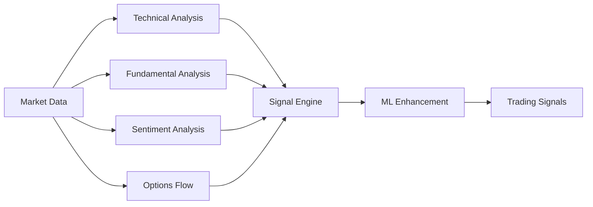

# TradeSense

Welcome to **TradeSense** - a sophisticated multi-factor trading signal scanner built with Python.

## Overview

TradeSense combines multiple analysis techniques to generate high-confidence trading signals:

## Key Features

| Feature | Description |
|---------|-------------|
| 📊 **Technical Analysis** | RSI, MACD, Bollinger Bands, Volume, Support/Resistance |
| 📈 **Fundamental Analysis** | P/E ratios, EPS beat/miss, Revenue analysis |
| 🧠 **Sentiment Analysis** | FinBERT NLP, Reddit WSB, StockTwits, Financial news |
| 📉 **Options Flow** | Put/Call ratio analysis |
| 🎯 **Adaptive Thresholds** | Volatility-based dynamic adjustments |
| 🔄 **Backtesting** | Historical validation with vectorbt |
| 🤖 **ML Predictions** | XGBoost and LSTM signal enhancement |

## Quick Links

- [Getting Started](getting-started.md) - Installation and setup
- [Configuration](configuration.md) - Customize your scanner
- [API Reference](api/reference.md) - Detailed API documentation

## System Requirements

- **Python**: 3.12+
- **GPU**: NVIDIA with CUDA 12.4 (recommended for ML features)
- **RAM**: 16GB+ recommended
- **OS**: Windows 11 (primary), Linux/macOS (compatible)

## License

MIT License - see [LICENSE](https://github.com/uzair-aftab/tradesense/blob/main/LICENSE) for details.

!!! warning "Disclaimer"
    This software is for educational and research purposes only. It is not financial advice. Always consult with a qualified financial advisor before making investment decisions.
