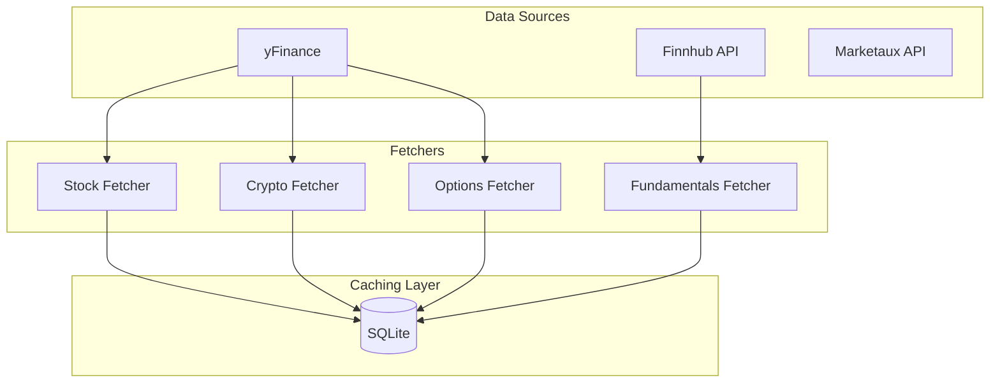

# Data Layer

The data layer handles all data fetching, caching, and management for TradeSense.

## Overview

## Components

### Stock Fetcher

::: src.data.fetcher_stocks.StockFetcher

### Crypto Fetcher

::: src.data.fetcher_crypto.CryptoFetcher

### Fundamentals Fetcher

::: src.data.fetcher_fundamentals.FundamentalsFetcher

### Options Fetcher

::: src.data.fetcher_options.OptionsFetcher

### Watchlist Manager

::: src.data.watchlists.WatchlistManager

## Caching

All data is cached in SQLite with configurable TTL:

| Data Type | Default TTL |
|-----------|-------------|
| Price Data | 15 minutes |
| Fundamentals | 24 hours |
| News | 1 hour |
| Options | 15 minutes |
