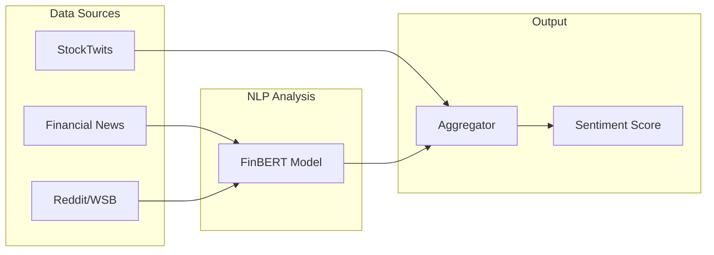

# Sentiment Engine

The sentiment engine analyzes financial news and social media to gauge market sentiment.

## Architecture



## FinBERT

TradeSense uses [FinBERT](https://huggingface.co/ProsusAI/finbert) for financial sentiment analysis:

- Pre-trained on 1.8M financial articles from Reuters
- 87% accuracy on Financial PhraseBank benchmark
- GPU-accelerated on your RTX 4070

### Example

```python
from src.sentiment.finbert_analyzer import FinBERTAnalyzer

analyzer = FinBERTAnalyzer()
results = analyzer.analyze([
    "Apple beats Q4 earnings expectations",
    "Tesla stock plunges on delivery miss"
])

print(results)
# [
#   {'text': '...', 'sentiment': 'positive', 'confidence': 0.94},
#   {'text': '...', 'sentiment': 'negative', 'confidence': 0.88}
# ]
```

## Data Sources

### News Fetcher
::: src.sentiment.news_fetcher.NewsFetcher

### Social Fetcher
::: src.sentiment.social_fetcher.SocialSentimentFetcher

### Aggregator
::: src.sentiment.aggregator.SentimentAggregator

## Sentiment Weights

| Source | Weight |
|--------|--------|
| News (FinBERT) | 40% |
| Reddit | 25% |
| Finnhub API | 20% |
| StockTwits | 15% |
