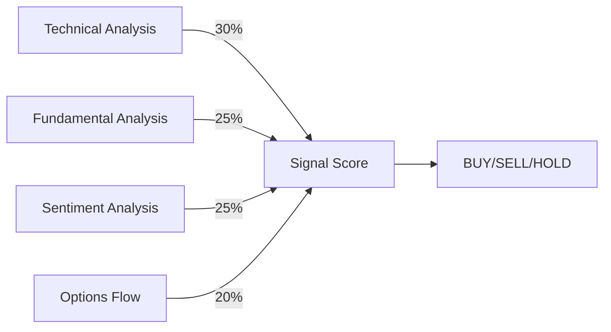

# Signal Generation

The signal generation module combines all analysis factors into actionable trading signals.

## Multi-Factor Scoring

TradeSense combines multiple factors to generate a confidence score:



## Signal Generator

::: src.signals.generator.SignalGenerator

## Adaptive Thresholds

::: src.signals.adaptive_thresholds.AdaptiveThresholds

## Take Profit / Stop Loss Calculator

::: src.signals.tp_sl_calculator.TPSLCalculator

## Example Output

```json
{
    "ticker": "AAPL",
    "signal": "BUY",
    "confidence": 0.85,
    "factors": {
        "technical": 0.9,
        "fundamental": 0.8,
        "sentiment": 0.85,
        "options": 0.7
    },
    "take_profit": 195.50,
    "stop_loss": 178.25,
    "risk_reward_ratio": 2.1,
    "reasoning": "RSI oversold (18), MACD bullish crossover, positive FinBERT sentiment..."
}
```
